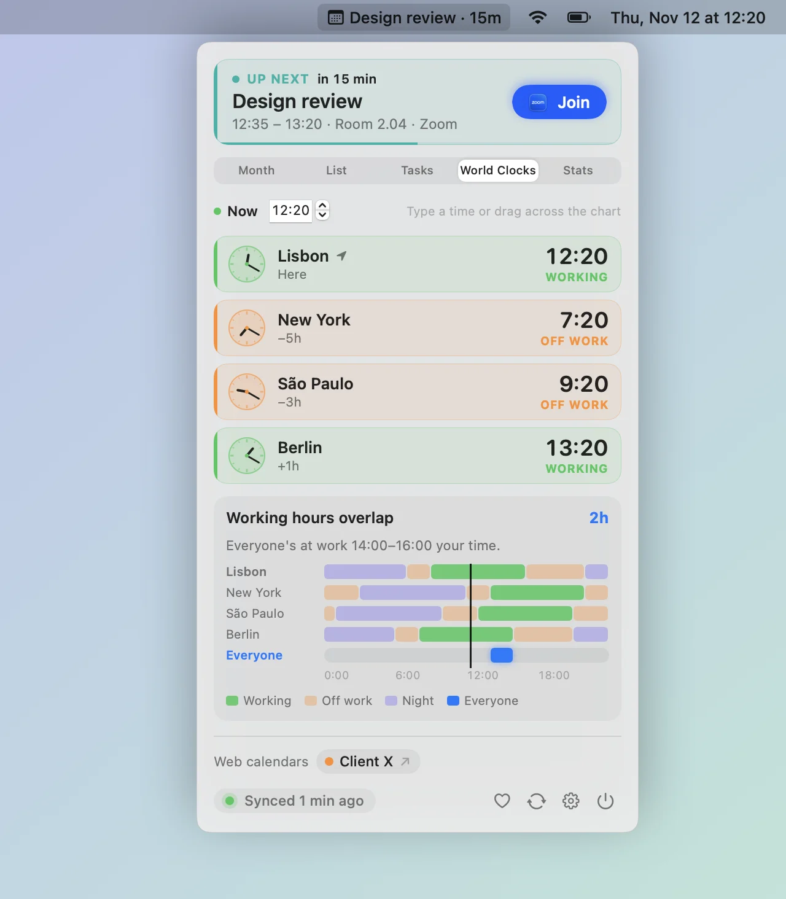
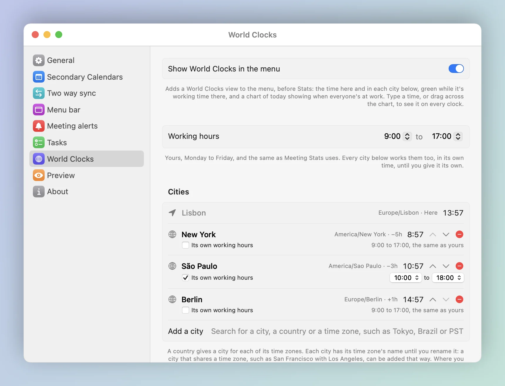

<div align="center">


# Calendar Hub

**Your secondary calendars' meetings, in your main calendar.**

A small Mac menu bar app that copies the meetings from your other calendars into the one your colleagues book you through, so nobody books you over a meeting they can't see. It also keeps your day in view: the next meeting a click away, a nudge when it starts, and the tasks to prepare it.

[](Support/Info.plist)
[](https://github.com/neteinstein/Calendar-Sync/actions/workflows/build.yml)

[](https://github.com/neteinstein/homebrew-tap)
[](https://formulae.brew.sh/analytics/install/365d/)
[](LICENSE.md)
[](https://www.pedrovicente.pt/donate)

<a href="https://github.com/neteinstein/Calendar-Sync/raw/main/docs/calendar-hub.mp4">
  
</a>

<sub>▶ <a href="https://github.com/neteinstein/Calendar-Sync/raw/main/docs/calendar-hub.mp4">Watch with sound</a> · 21 seconds</sub>

</div>

---

## How to install

With [Homebrew](https://brew.sh/):

```bash
brew install neteinstein/tap/calendar-hub
brew services start neteinstein/tap/calendar-hub
```

The second command starts it now and at every login. It needs macOS 14 or later; more in [Install](#install).

Calendar Hub was called Calendar Sync up to 2.0.19. Coming from `calendar-sync`? See [Coming from Calendar Sync](docs/install.md#coming-from-calendar-sync).

## Why

Booked solid in another calendar. Wide open in your main calendar.

When your meetings live in a secondary calendar (another company's account, a second job, a personal calendar), your main calendar says you're free all day. Calendar Hub copies each meeting across as **`[Calendar A] Sprint planning`**, with its join link, and keeps the copy right when the meeting moves or is cancelled.

## A look around

### The menu

<table>
<tr>
<td width="50%" valign="top">
<picture>
  <source media="(prefers-color-scheme: dark)" srcset="docs/screenshots/menu-month-dark.webp">
  
</picture>
<b>Month.</b> The next meeting with a countdown and <b>Join</b>, and the month with a dot for each calendar that has meetings that day. Click a day for its meetings.
</td>
<td width="50%" valign="top">
<picture>
  <source media="(prefers-color-scheme: dark)" srcset="docs/screenshots/menu-list-dark.webp">
  
</picture>
<b>List.</b> Opens at today, with a line at the current time, the finished meetings folded away, and <b>Join</b> as a meeting comes up.
</td>
</tr>
<tr>
<td width="50%" valign="top">
<picture>
  <source media="(prefers-color-scheme: dark)" srcset="docs/screenshots/menu-tasks-dark.webp">
  
</picture>
<b>Tasks.</b> Tasks and reminders, kept in Reminders. Tie one to a meeting to prepare it, and set nudges to get it done. They move with the meeting, show on its alert, and on their day in Month and List.
</td>
<td width="50%" valign="top">
<picture>
  <source media="(prefers-color-scheme: dark)" srcset="docs/screenshots/menu-clocks-dark.webp">
  
</picture>
<b>World Clocks.</b> The time in the cities you work with, green while they're at work. Type a time, or drag across the chart, to see it on every clock, and see when everyone's working hours overlap.
</td>
</tr>
<tr>
<td width="50%" valign="top">
<picture>
  <source media="(prefers-color-scheme: dark)" srcset="docs/screenshots/menu-stats-dark.webp">
  
</picture>
<b>Stats.</b> Where your week goes: hours in meetings, the last two weeks, your busiest day, the free time left today, and a year of it pictured as a trip.
</td>
<td width="50%" valign="top">
</td>
</tr>
</table>

### Task notes

<picture>
  <source media="(prefers-color-scheme: dark)" srcset="docs/screenshots/task-notes-dark.webp">
  
</picture>

Open a task's notes in a window of their own: Markdown, formatted as you type, with buttons for headings, bold, lists, checklists and links. They're saved in the reminder's notes, so Reminders has them too.

### When a meeting starts

<picture>
  <source media="(prefers-color-scheme: dark)" srcset="docs/screenshots/alert-dark.webp">
  
</picture>

The screen blurs and a card counts down to the start, with the meeting's open tasks **to prepare**, and **Join call** (⏎), **Go to** the room, **Ignore** (esc) or **Remind me in 1 minute**. Any other key, or a click anywhere but the buttons, ignores it too. It's on unless you turn it off, and each meeting alerts once.

### In the menu bar

<picture>
  <source media="(prefers-color-scheme: dark)" srcset="docs/screenshots/menu-bar-dark.webp">
  
</picture>

Today's date, or, if you like, the next meeting and the minutes left when it's 15 minutes away, with a bar under it that fills as the meeting runs.

### Settings

<table>
<tr>
<td width="50%" valign="top">
<picture>
  <source media="(prefers-color-scheme: dark)" srcset="docs/screenshots/settings-calendars-dark.webp">
  
</picture>
</td>
<td width="50%" valign="top">
<picture>
  <source media="(prefers-color-scheme: dark)" srcset="docs/screenshots/settings-menuBar-dark.webp">
  
</picture>
</td>
</tr>
</table>

<details>
<summary><b>The other panes</b></summary>
<br>

<picture>
  <source media="(prefers-color-scheme: dark)" srcset="docs/screenshots/settings-general-dark.webp">
  
</picture>
<picture>
  <source media="(prefers-color-scheme: dark)" srcset="docs/screenshots/settings-twoWaySync-dark.webp">
  
</picture>
<picture>
  <source media="(prefers-color-scheme: dark)" srcset="docs/screenshots/settings-alerts-dark.webp">
  
</picture>
<picture>
  <source media="(prefers-color-scheme: dark)" srcset="docs/screenshots/settings-tasks-dark.webp">
  
</picture>
<picture>
  <source media="(prefers-color-scheme: dark)" srcset="docs/screenshots/settings-worldClocks-dark.webp">
  
</picture>
<picture>
  <source media="(prefers-color-scheme: dark)" srcset="docs/screenshots/settings-about-dark.webp">
  
</picture>

</details>

<sub>Screenshots show sample calendars.</sub>

## What it does

- **Copies your meetings across**, titled by the calendar they came from, with the Teams, Zoom, Google Meet or Webex link, so **Join** works from your main calendar.
- **Keeps the copies right:** moved meetings move, cancelled ones disappear, and recurring meetings just work.
- **Reads calendars your Mac can't add:** sign in to **Outlook on the web** once in the app, or subscribe to a published **.ics** link.
- **Hides meeting names** for a calendar if you'd rather: its copies read `[Calendar A] Busy`. On from the start for Outlook on the web calendars. The join link can be left out too, so nothing but the time crosses over.
- **Syncs both ways**, if you like: your main calendar shows as **Busy** in your secondary calendars, with nothing else in it, not even alerts, so a meeting doesn't notify you twice.
- **Keeps your tasks** in a Tasks view and on their day in Month and List, as reminders in Reminders, so they're on your iPhone too and stay if you remove the app. A task can be for a meeting, moves with it, nudges you when you say, and has notes in Markdown.
- **Compares time zones** in a World Clocks view: the time in the cities you work with, green during working hours, at any time you pick, and when everyone's working hours overlap.
- **Stays out of the way:** it never copies attendees, so no invites go out, never copies its own copies back, and leaves copies alone when a calendar can't be read.

## What leaves your Mac, and where it ends up

Copying a meeting from one calendar into another puts data from one organization on another's server, so here is exactly what moves. Nothing goes anywhere else: the app has no server, no analytics and no crash reporting.

| What | Where it ends up | When |
|---|---|---|
| The secondary calendar's name, the meeting's start and end, and a hashed tag | Your main calendar's server (Exchange, Google, iCloud, …) | Every copy. The tag is a hash, so it says nothing about the meeting. |
| The meeting's name | Same | Unless **Hide meeting names** is on for that calendar. It's on from the start for Outlook on the web calendars. |
| The join link (Teams, Zoom, Google Meet, Webex) | Same | Unless **Copy the meeting link** is off for that calendar. A Teams link names the organization and the organizer, and a Zoom link can carry the passcode. |
| The meeting's location and description | Same | Only with **Copy location and description** on, and never while names are hidden. |
| A **Busy** block with the time and a description that says "Busy" plus an opaque code | Each secondary calendar you chose | Only with **Two way sync** on. No title, link, location, attendees or alerts, and nothing that names the app. |
| A task's title and notes, and the name and start of the meeting it's for | Your Reminders account (iCloud, say) | Only for tasks you make in the Tasks view. |
| Your Outlook on the web sign-in | The app's own WebKit folder in your Library, on this Mac | Only for Outlook on the web calendars. See [Outlook on the web](docs/outlook-on-the-web.md). |
| One request for the newest version number | GitHub, over HTTPS | Once a day, and when you check in Settings › About. GitHub sees your IP address, nothing else. |

Nothing identifies a meeting in the system log: the app logs counts and times, not names.

## Install

With [Homebrew](https://brew.sh/):

```bash
brew install neteinstein/tap/calendar-hub
```

It needs macOS 14 or later and the Xcode command line tools: Homebrew builds the app on your Mac.

### Run it

Once:

```bash
open "$(brew --prefix)/opt/calendar-hub/Calendar Hub.app"
```

Or every time you log in:

```bash
brew services start neteinstein/tap/calendar-hub
```

The first time it runs, it links itself into your Applications folder, so you can also open it from Finder or the Dock.

### Set it up

1. Allow calendar access when macOS asks.
2. Open **Settings…** from the menu bar icon, and in **General** choose your main calendar.
3. In **Secondary Calendars**, add the calendars to copy from.

That's it. It syncs every 15 minutes, and calendars in Calendar.app within seconds of a change.

### Update

```bash
brew update && brew upgrade calendar-hub
```

Then restart it with `brew services restart calendar-hub`, or just open it again: the new version takes over from the old copy. Or let the app do it: it checks for a new version once a day, and when there is one, a blue **update** button appears next to **Sync now** in the menu. Click it and Terminal runs these commands and restarts the app. More in [Install and update](docs/install.md), including building from source.

## Feedback and issues

Found a bug, or have an idea? [Open an issue](https://github.com/neteinstein/Calendar-Sync/issues). Settings › About › **Send feedback or report a bug** takes you there too.

## Learn more

- [Install and update](docs/install.md): Homebrew in detail, opening at login, building from source, a separate admin account, and a missing menu bar icon.
- [How it works](docs/how-it-works.md): how copies are made and matched, two way sync, the menu, the alert, tasks and Meeting Stats in detail, and known limits.
- [Outlook on the web](docs/outlook-on-the-web.md): how the app reads (and can write to) a browser-only Outlook calendar, and what to check first.
- [Development](docs/development.md): tests, how the code is laid out, screenshots and releases.

## License

Calendar Hub is source-available under the [Sustainable Use License 1.0](LICENSE.md) (SPDX `SUL-1.0`). You can use and change it for free, for personal use or at work, **including commercially** for your own business. You can share it, with or without your changes, as long as you do so for free and for noncommercial purposes. Selling it, building a product or service from it, or including it in one needs a separate licence from the author.

Copyright (c) 2026 Pedro Vicente (https://github.com/neteinstein)

<div align="center">
<br>
<sub>Demo video made with <a href="https://github.com/latent-spaces/brag">/brag</a>.</sub>
</div>
