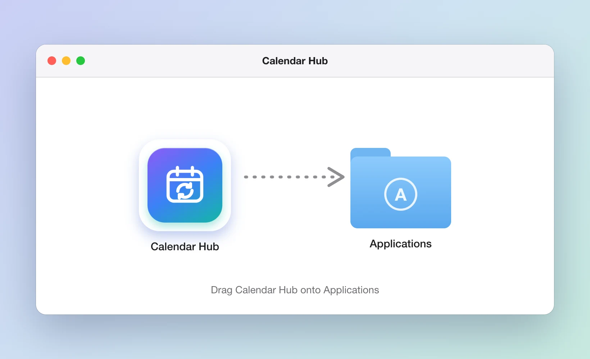
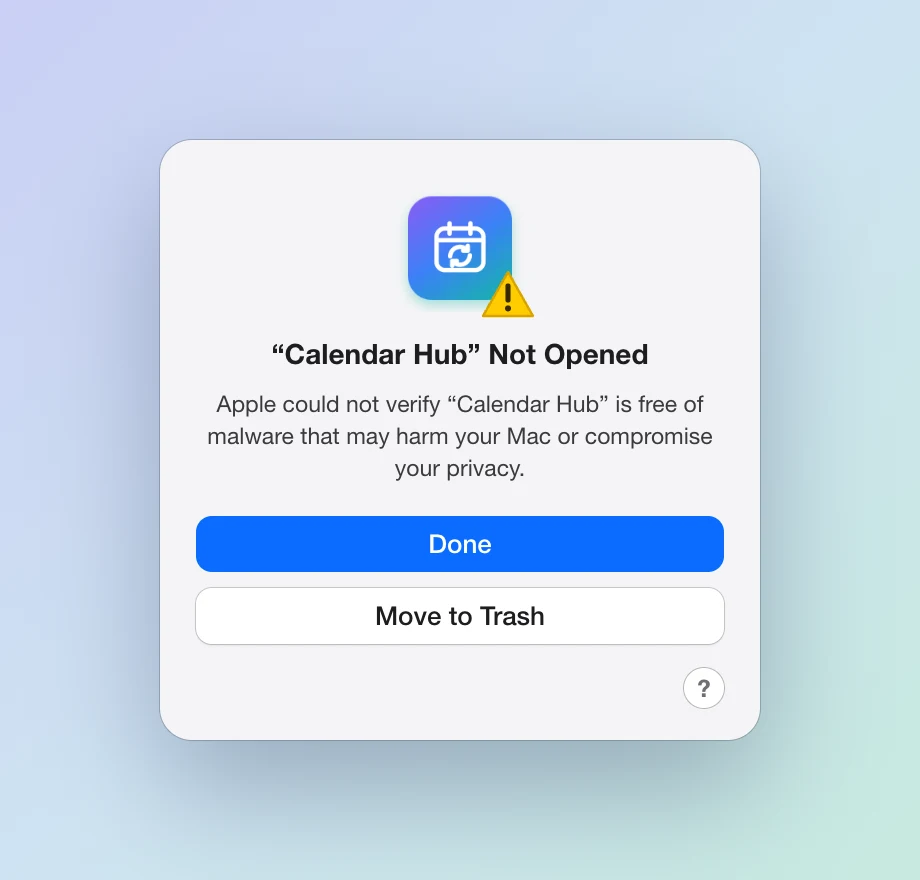
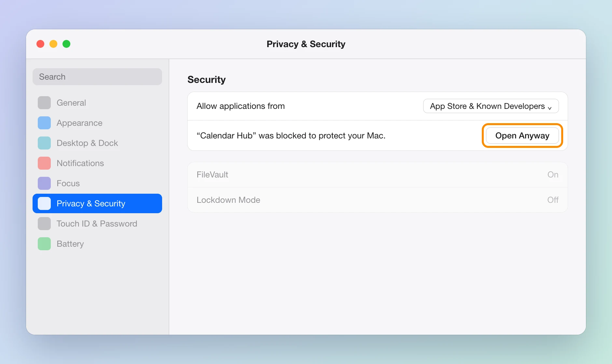

# Install Calendar Hub

Calendar Hub puts your other calendars' meetings into your main calendar, so nobody books you over a meeting they can't see. It lives in your Mac's menu bar.

You need a Mac with **macOS 14 (Sonoma) or later**. It takes about two minutes.

## 1. Download it

Download **[Calendar-Hub.dmg](https://github.com/neteinstein/Calendar-Hub/releases/latest/download/Calendar-Hub.dmg)**. It's in your Downloads folder when it's done.

## 2. Drag it into Applications

Open **Calendar-Hub.dmg**. A window opens: drag **Calendar Hub** onto the **Applications** folder.

## 3. Open it, and allow it

Open **Applications** in Finder and double-click **Calendar Hub**.

The first time, macOS stops it. Calendar Hub is free and isn't signed by Apple, so macOS can't check it and says it's not opened. Click **Done**. Don't click Move to Trash.

Now allow it:

1. Open the Apple menu › **System Settings**.
2. Click **Privacy & Security** in the sidebar.
3. Scroll down to **Security**. Next to “Calendar Hub” was blocked to protect your Mac, click **Open Anyway**.
4. Click **Open Anyway** again and enter your Mac's password (or use Touch ID).

You only do this once. From then on it opens like any other app.

## 4. Set it up

A calendar icon appears in the menu bar, at the top right of your screen.

1. Click **Allow** when macOS asks for access to your calendars.
2. Click the calendar icon, then the gear (**Settings**). In **General**, choose your main calendar: the one your colleagues book you through.
3. In **Secondary Calendars**, add the calendars whose meetings you want copied across.

That's it. To have it start whenever you log in, turn on **Open at login** in Settings › General.

## Updating

When a new version is out, a blue **update** button appears in the menu. Click it to download the new version. Then:

1. Quit Calendar Hub: click the power button in its menu.
2. Open the new **Calendar-Hub.dmg** and drag Calendar Hub into Applications. Choose **Replace** when asked.
3. Open it, and allow it once more with **Open Anyway** (step 3 above).

Your settings are kept. macOS asks for calendar access again.

## Removing it

Quit Calendar Hub, then drag it from Applications to the Bin. The meetings it copied stay in your calendar.

## Something not right?

- **No calendar icon in the menu bar?** Your menu bar may be full, or the icon hidden. See [No icon in the menu bar?](install.md#no-icon-in-the-menu-bar).
- **Anything else:** [report a problem](https://github.com/neteinstein/Calendar-Hub/issues/new), or use **Send feedback** in Settings › About.

More about what Calendar Hub does is in the [README](../README.md).
