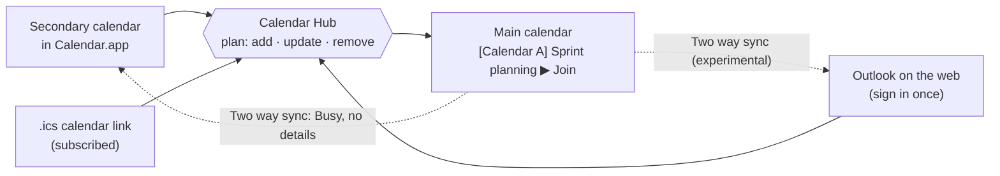

# How it works

[← Back to the README](../README.md)

## Copies

- **Named by its calendar.** Each copy is titled **`[Calendar name] Meeting name`**, e.g. `[Calendar A] Sprint planning`. For calendars in Calendar.app it uses the calendar's own name and picks up renames. With **Hide meeting names** on for a calendar, its copies are titled `[Calendar A] Busy` instead, and the meeting link still comes along unless **Copy the meeting link** is off too. Names are hidden from the start for Outlook on the web calendars.
- **Meeting link included.** Teams, Zoom, Google Meet and Webex links are copied onto the event and shown first in its notes, so **Join** works straight from your main calendar. Turn off **Copy the meeting link** for a calendar to leave it out: a Teams link names the organization and the organizer, and a Zoom link can carry the passcode. Without it, **Join** isn't offered for those copies.
- **Matched by a hidden tag.** Every copy ends its notes with a tag like `calsync:v1:<source id>:<hash>`. The hash is made from the occurrence's own id and the source id, so the tag says nothing about the meeting, not even when the id is built from its title, as Outlook on the web ones are. The app uses it to recognise its own copies and match them to their originals, not by title and time. So a moved meeting gets updated instead of duplicated, a cancelled one is removed, and recurring meetings just work. Copies made by versions before 2.0.6, whose tag held the id in the clear, get the hashed tag on their next sync, updated in place.
- **Only its own copies.** An event counts as a copy only if it carries the tag and, like everything the app saves, has no attendees and no organizer but you. So an invitation from someone else can't be taken for a copy, whatever its description says, and removed by a sync.
- **Safe by design.** It never copies attendees, so no invites go out. It never copies its own copies back, so two-way setups don't loop. If a calendar can't be read, its copies are left alone.
- **What's copied.** You can **skip meetings you declined**, **skip all-day events** and **skip out-of-office events** (on by default). Per secondary calendar, copies can also get the meeting's **location and description**, and you can leave out **meetings you haven't accepted**: ones you haven't answered, accepted tentatively or declined. Your own events, and the ones you organise, count as accepted. When Outlook on the web doesn't say whether you accepted, a meeting shown as tentative counts as not accepted.

It syncs **every 15 minutes** by default; set any interval from 1 minute to 24 hours, and give a secondary calendar **its own interval** when it should sync more or less often than the rest (say, Outlook on the web hourly). Calendar.app calendars also sync about 10 seconds after a change. Settings has a **Preview** that shows what the next sync would change before it changes anything.

## Secondary calendars it can read

| Secondary calendar | How to add it |
|---|---|
| **Added to Calendar.app** (Exchange, Google, iCloud, …) | **Add secondary calendar › From Calendar.app** |
| **Browser only, with a published link** | **Add secondary calendar › Calendar link (.ics)**. Calendar.app subscribes to the link, then you pick it like any other calendar. |
| **Browser only: Outlook / Microsoft 365** | **Add secondary calendar › Outlook on the web**. Sign in once in the app's own window (MFA included, also with a USB security key). Each sync reloads Outlook's week view in the background, reads the meetings it loads, then loads each meeting in full for its join link and details. *Experimental.* See [Outlook on the web](outlook-on-the-web.md). |

## Two way sync

Optional, in the **Two way sync** pane. Your main calendar's events are added to your secondary calendars as plain **Busy** events — or **Out of office**, your pick per calendar — with the time and nothing else: no title, link, location, attendees or alerts, so a meeting doesn't notify you twice. Their description says “Busy” and a code, the same for every Busy event in that calendar (a hash of the calendar's id in the app). The code is how the app tells its own Busy events from any other event titled Busy; nothing in them names the app or the meeting they stand for. Copies of a secondary calendar's own meetings are skipped, and meetings copied from the other secondary calendars do show, so each one sees the time the others have booked. It works with secondary calendars you can edit in Calendar.app and, if you also turn on **Also sync Outlook on the web calendars** (experimental), with Outlook on the web calendars. `.ics` link calendars are read-only.

The app recognises its Busy events by the code, and matches them to your main calendar by time. Busy events made by versions 2.0.0 to 2.0.5 carried no code: those are recognised by their title (**Busy** or **Out of office**), a description that is just “Busy”, having no attendees and not repeating, and get the code on their next sync. Until then, an event you made yourself that looks exactly like that is treated as one of them in a calendar two way sync writes to.

## The menu

- **Up next.** The menu leads with the next meeting today, or the one under way, with a countdown and a **Join** button.
- **Month view.** Turn on **Show a calendar in the menu** and the icon gains **today's date** (add the **week day** next to it if you like). The month shows a dot for each calendar with meetings that day; click a day for its events. Start the week on **Sunday or Monday**, and hide **weekends** if you like.
- **List view.** A scrolling list of your main calendar's events. It opens at today, with a line at the current time, today's finished meetings folded into one row, and each day's header kept in view while you scroll. Copies show the meeting's own name, with the calendar it came from under it, and a **Join** button appears from 15 minutes before a meeting. A meeting with tasks shows how many; right-click one to **add a task** for it.
- **Tasks view.** Your tasks, by when they're due: overdue, today, tomorrow, later and no date, with the ones done this week folded away. Month and List show each day's tasks too. See [Tasks](#tasks).
- **Colors.** The lists tint each event with the **color of the calendar it came from**, shade **all-day events**, and group each day's **morning** and **afternoon** into colored blocks. Each of these can be turned off.
- **Status.** A pill says when the last sync ran. Anything that went wrong shows as a card with its fix, like **Open Outlook** for a calendar that signed you out; click the pill's count to see it in Settings.
- **Next meeting in the menu bar.** Turn on **Show the next meeting in the menu bar** and, from 15 minutes before a meeting until it ends, the icon shows its name and the minutes left, like `Design review · 12m`. With that on, **Show the meeting's progress under its title** adds a bar under the name that fills as the meeting runs; it stays off and greyed out while the next meeting isn't shown.

## The meeting alert

The **full-screen alert** (on unless you turn it off) blurs the screen when a main-calendar meeting begins, or up to 15 minutes before, and counts down to the start. The meeting's open tasks are listed **to prepare**. Its buttons: **Join call** (⏎), **Go to** the room, **Ignore** (esc), or **Remind me in 1 minute**. Any other key, or a click anywhere but the buttons, ignores it too. Meetings copied from secondary calendars alert too, join link and calendar name included. Each meeting alerts once; a meeting already under way (say, after the Mac wakes) alerts until it ends.

## Tasks

The **Tasks** view sits between List and Stats (turn it off in Settings › Tasks). Type a task and press Return for one with no date, or open it for more: notes, a **due date**, the **meeting it's for**, and **nudges**.

- **Kept in Reminders.** Each task is a reminder in a Reminders list you pick (by default the one Reminders adds new reminders to). So it's on your iPhone and other devices too, you can tick it off anywhere, and it stays if you remove Calendar Hub. Reminders already in that list show up as tasks. The app asks for access to Reminders the first time you open the view.
- **For a meeting.** Pick a meeting from the next month, or right-click it in the List. The task is due when the meeting starts, its open tasks show **to prepare** on the meeting's alert, and the link is saved in the reminder's URL field (`calendarhub://event?…`), so Reminders keeps it too.
- **Nudges.** A nudge is one of the reminder's alerts, so Reminders shows it as a notification on all your devices, even while Calendar Hub isn't running. Pick one timed by the due date or the meeting (when it starts, 5, 15 or 30 minutes or an hour before, that day or the day before at 9:00) or a set time, and as many as you like. New tasks get the nudge set in Settings › Tasks: an hour before a meeting, and at the due time otherwise.
- **Notes in a window.** Open a task's notes in a window of their own (the page button on its row, or in its editor) for more room and formatting: a Markdown editor that styles headings, bold, italic, code, links, quotes, lists and checklists as you type, with a bar of buttons, ⌘B, ⌘I, ⌘E and ⌘K. Return carries a list on, and a click ticks a checklist box. They're saved as you type, as Markdown in the reminder's notes, so Reminders has them too.
- **On the calendar.** Month marks a day with open tasks with a ring after its dots, and a picked day lists its tasks above its meetings. In List, each day starts with its tasks, and today with the overdue ones too. Tick them off there, or click one to open it.
- **Moves with the meeting.** After each sync, a task for a meeting that moved has its due date and nudges moved by as much, so an hour before stays an hour before. A meeting that's gone or cancelled is marked as removed, and its tasks stay as they are.

## World Clocks

Turn on **World Clocks** in Settings › World Clocks and add the cities you work with: search by city, country, region or a time zone abbreviation such as PST (a country gives a city for each of its time zones: Brazil, say, or United States), and rename a city to one that shares its time zone (Los Angeles as San Francisco). Where you are comes first, named after your Mac's time zone; rename it too (Lisbon as Porto), and it keeps that name while your Mac is in that time zone. The menu gains a **World Clocks** view, before Stats, with the time here and in each city, how far ahead or behind it is, and whether it's **working**, **off work** or **night** there (22:00 to 7:00). Working time is Monday to Friday: yours uses the same working hours as Meeting Stats, and every city works those too, in its own time, until you tick **Its own working hours** for it and set them (a team that works 10:00 to 18:00, say). Below the clocks, a chart of today in your time shows each city's day and an **Everyone** row for when all of them are at work. Type a time, or click or drag across the chart, to see it on every clock; **Back to now** returns to the current time.

## Meeting Stats

Turn on **Meeting Stats** and the menu gains a **Stats** view: hours in meetings **yesterday, today and tomorrow**, a chart of the **last two weeks**, **last week** (and how it compares with the week before) and **last month**, your **average per working day**, your **busiest weekday**, how many meetings ran **back to back**, the **longest free block** left today and when it is, the **meeting-free time** in today's and tomorrow's working hours, how much of this week's working hours you're **out of office**, and a **prediction for the year**, pictured as a trip, like walking from Lisbon to Paris.

Only timed meetings in your main calendar count: all-day, declined and out-of-office events don't. Overlapping meetings count once, with the total counting overlap next to it, like "20 hours (25 counting overlap)". Out of office counts the time it covers within working hours, Monday to Friday. Working hours are 9:00 to 17:00 unless you set your own in Settings.

## Updates

The app checks GitHub for a newer version **once a day**, counting the day across sleep and restarts, and Settings' **About** pane can check now. A Homebrew install compares with the version the [tap](https://github.com/neteinstein/homebrew-tap) serves, since that's what `brew upgrade` installs and it can trail `main` for a while; a source build compares with the newest release, or the version on `main` while there are no releases.

When there is one, a blue **update** button appears next to **Sync now** in the menu. Click it, confirm, and Terminal opens and runs the update: `brew update` and `brew upgrade calendar-hub` (as the account that owns Homebrew, if that's a separate admin account, so Terminal asks for its password), or `git pull` and `scripts/build-app.sh` for a source build. Then it restarts the app, through `brew services` if that started it. It stops at the first error and leaves the running copy alone, and the Terminal window shows what went wrong. Settings shows a warning too, with an **Update** button that shows the commands to run by hand and can run them in Terminal the same way. A source build moved out of its clone can't update by itself: its button opens those instructions.

## Known limits

- Calendar.app refreshes accounts every few minutes, so changes made in a secondary calendar show up with that delay.
- If you remove a secondary calendar from the app, the copies already made from it stay in your calendar, and the Busy events two way sync added to it stay in the secondary calendar. Delete them in Calendar if you no longer want them. To have the app take the Busy events back, turn off **Show my main calendar here** (or **Sync both ways**) and let it sync before removing the calendar.
